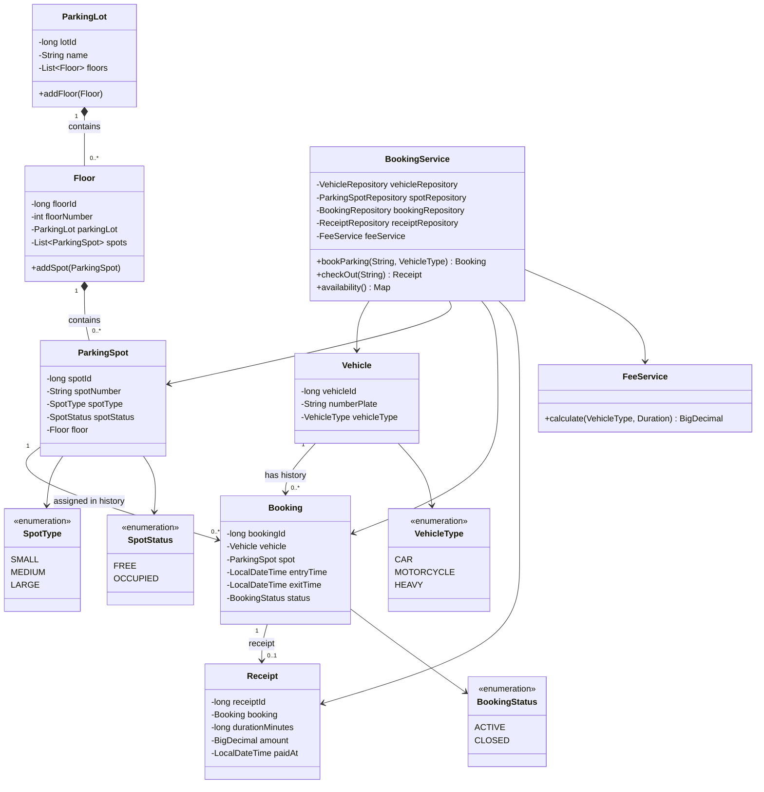

# Class Model — Smart Parking Lot System

## 1. Overview

The model is organized around parking-lot structure, vehicles, bookings, and receipts. JPA entities represent persisted domain data. Services implement booking and fee-calculation behavior; repositories provide database access; enums constrain status and type values.

## 2. UML Class Diagram

## 3. Core Classes

### `ParkingLot`
Represents a named parking facility. It owns a collection of floors and provides `addFloor`, which also assigns the floor's parent reference.

### `Floor`
Represents a floor in a parking lot. It references its parent `ParkingLot` and contains a collection of parking spots. `addSpot` adds the spot and assigns its floor reference.

### `ParkingSpot`
Represents one parking space. It has a spot number, capacity category (`SMALL`, `MEDIUM`, `LARGE`), current occupancy state (`FREE`, `OCCUPIED`), and parent floor.

### `Vehicle`
Represents a vehicle identified by a unique number plate. Its `VehicleType` determines which parking-spot categories it can use and the hourly fee.

### `Booking`
Represents a parking session. It links a vehicle to a spot and records entry time, optional exit time, and lifecycle status (`ACTIVE` or `CLOSED`).

### `Receipt`
Represents the charge generated when a booking is checked out. It stores the associated booking, duration in minutes, fee amount, and timestamp. The booking reference is unique, supporting at most one receipt per booking.

### `BookingService`
Orchestrates check-in, spot allocation, checkout, availability, booking persistence, spot status updates, and receipt creation. Its booking and checkout methods are transactional.

### `FeeService`
Calculates the parking fee using vehicle type and stay duration. It charges for started hours, with a minimum of one hour.

## 4. Enumerations

| Enum | Values | Purpose |
|---|---|---|
| `VehicleType` | `CAR`, `MOTORCYCLE`, `HEAVY` | Classifies vehicles |
| `SpotType` | `SMALL`, `MEDIUM`, `LARGE` | Classifies parking spaces |
| `SpotStatus` | `FREE`, `OCCUPIED` | Tracks current spot availability |
| `BookingStatus` | `ACTIVE`, `CLOSED` | Tracks parking-session lifecycle |

## 5. Service Dependencies

`BookingService` uses constructor injection for:
- `VehicleRepository`
- `ParkingSpotRepository`
- `BookingRepository`
- `ReceiptRepository`
- `FeeService`

`FeeService` is independent of repositories and calculates amounts from its input parameters.

## 6. Design Notes

- Generated IDs are managed by JPA.
- Entity relationships are persisted through foreign keys.
- `BigDecimal` is used for money values.
- `@Transactional` groups related booking and checkout updates.
- The current console runner invokes service methods directly; REST controllers are not part of the current implementation.
- For stronger encapsulation, future revisions could expose domain methods for changing spot and booking states instead of relying on public setters.
