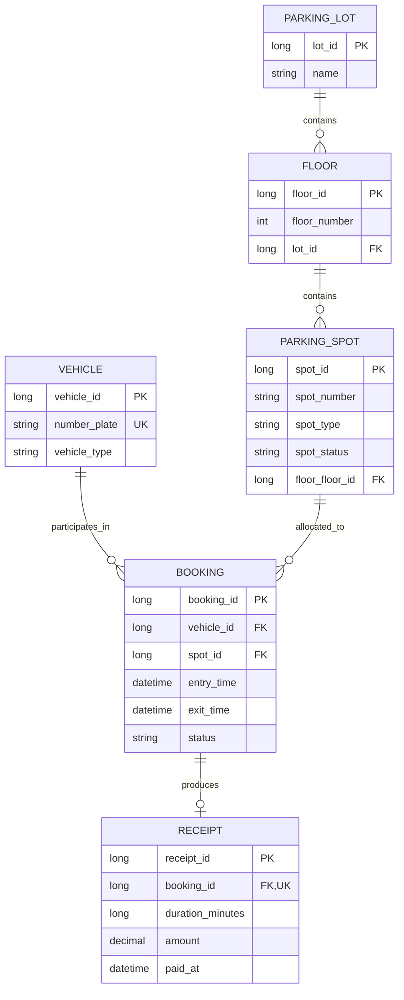

# Object Relationships — Smart Parking Lot System

## 1. Entity Relationship Overview

## 2. Relationship Details

### Parking lot to floors
- **Cardinality:** One-to-many.
- **Java side:** `ParkingLot.floors` and `Floor.parkingLot`.
- **JPA mapping:** `ParkingLot.floors` is the inverse collection using `mappedBy = "parkingLot"`; `Floor.parkingLot` owns the foreign key.
- **Cascade:** The parking lot uses `CascadeType.ALL` for its floors.
- **Helper method:** `ParkingLot.addFloor(floor)` adds the floor and calls `floor.setParkingLot(this)`.

### Floor to parking spots
- **Cardinality:** One-to-many.
- **Java side:** `Floor.spots` and `ParkingSpot.floor`.
- **JPA mapping:** `Floor.spots` is the inverse collection using `mappedBy = "floor"`; `ParkingSpot.floor` owns the foreign key.
- **Cascade:** The floor uses `CascadeType.ALL` for its spots.
- **Helper method:** `Floor.addSpot(spot)` adds the spot and sets its floor reference.

### Vehicle to bookings
- **Cardinality:** One vehicle can have many bookings over time; each booking belongs to one vehicle.
- **JPA mapping:** `Booking.vehicle` is a `@ManyToOne` relationship with a foreign key named `vehicle_id`.
- **Constraint:** `Vehicle.numberPlate` is unique.
- **Business rule:** A vehicle should have no more than one active booking at a time. The service checks this before creating a booking; this rule should also be tested under concurrent requests.

### Parking spot to bookings
- **Cardinality:** One spot can appear in many historical bookings; each booking references one spot.
- **JPA mapping:** `Booking.spot` is `@ManyToOne` with a foreign key named `spot_id`.
- **Business rule:** A spot can be allocated only while its current status is `FREE`. Check-in changes it to `OCCUPIED`, and checkout changes it back to `FREE`.

### Booking to receipt
- **Cardinality:** A booking can have zero or one receipt; each receipt references exactly one booking.
- **JPA mapping:** `Receipt.booking` is a `@OneToOne` relationship.
- **Constraint:** The `booking_id` column is non-null and unique, preventing multiple receipts from referencing the same booking.
- **Lifecycle:** A receipt is created at checkout after the stay duration and fee are calculated.

## 3. Object Lifecycle

### Check-in

1. Normalize and validate the vehicle number plate.
2. Reject the operation if the vehicle already has an active booking.
3. Find an existing vehicle or persist a new one.
4. Find a compatible free parking spot.
5. Mark the spot `OCCUPIED`.
6. Create a `Booking` with `entryTime` set and status `ACTIVE`.
7. Persist the booking in the same transaction.

### Checkout

1. Find the vehicle's active booking.
2. Record `exitTime`.
3. Change booking status to `CLOSED`.
4. Change the assigned spot status to `FREE`.
5. Calculate stay duration and fee.
6. Create and persist the receipt.
7. Commit the transaction so the booking, spot, and receipt changes remain consistent.

## 4. Status Values

| Object | State | Meaning |
|---|---|---|
| `ParkingSpot` | `FREE` | Available for a compatible vehicle |
| `ParkingSpot` | `OCCUPIED` | Currently allocated |
| `Booking` | `ACTIVE` | Vehicle is currently parked |
| `Booking` | `CLOSED` | Parking session has ended |

## 5. Consistency Considerations

- Keep both sides of parent-child relationships synchronized using helper methods such as `addFloor` and `addSpot`.
- Keep booking status and spot status consistent within a transaction.
- A unique receipt-to-booking constraint protects against duplicate receipt records.
- The service-level active-booking check alone may not prevent two concurrent check-ins for the same vehicle; production deployments need a concurrency-safe design and tests.
- Since H2 is in-memory, persisted records are lost when the application stops.
